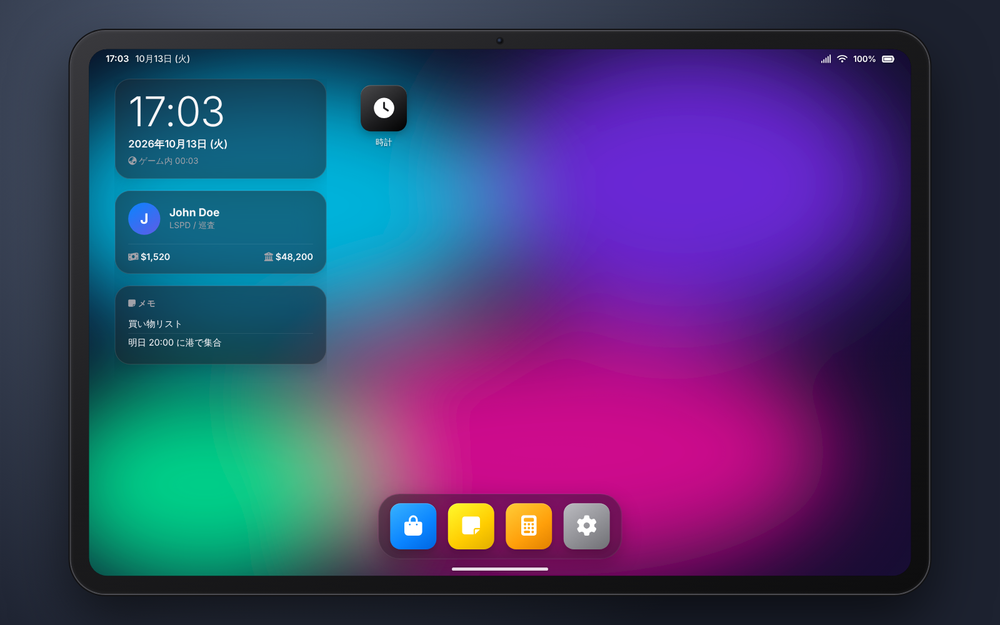
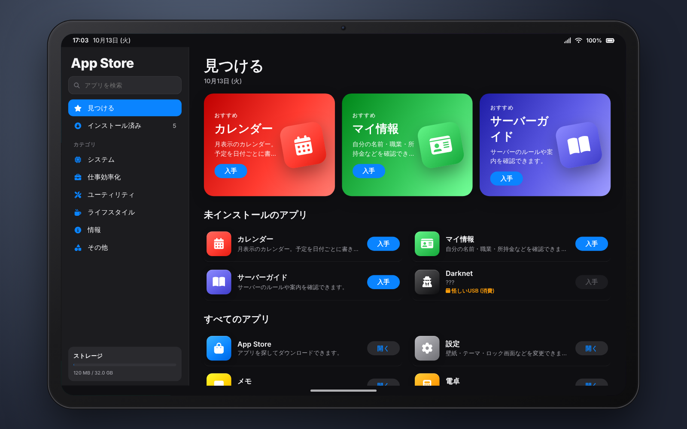
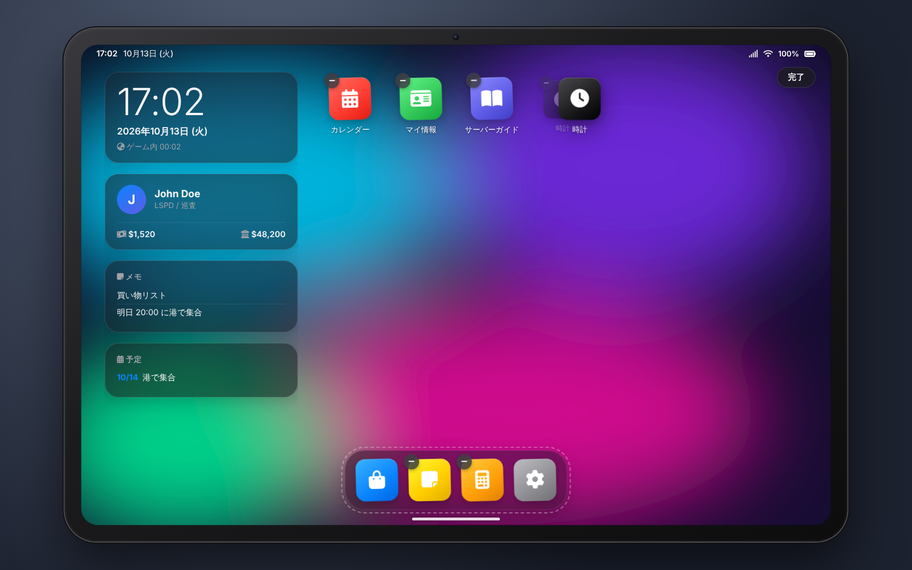
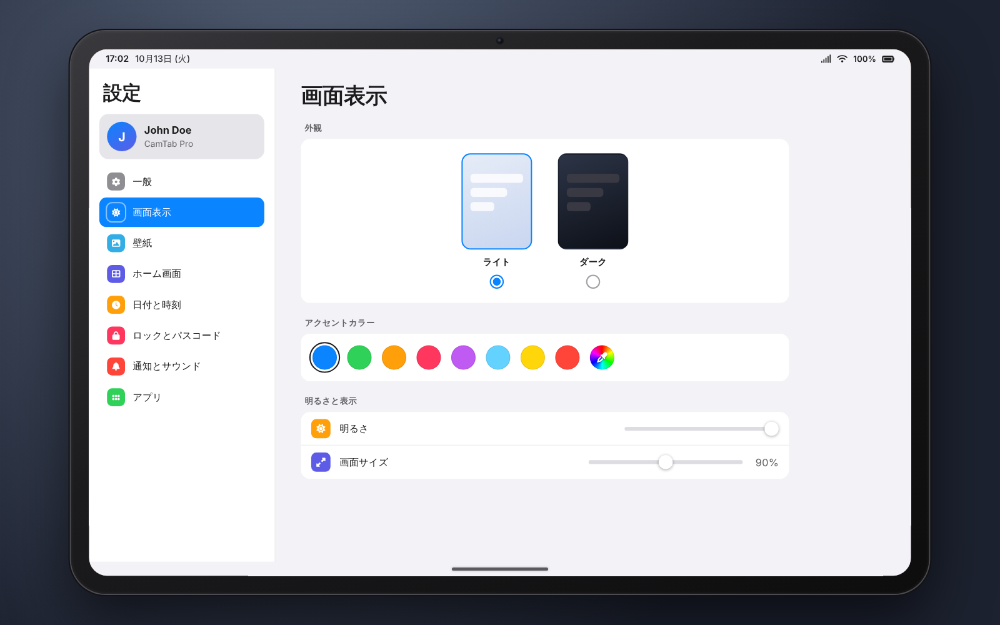

# cam_tablet

QBox (qbx_core) 用のタブレット UI リソースです。

- ホーム画面（ウィジェット・アプリグリッド・ドック）
- ロック画面（4桁パスコード対応）
- App Store（検索・カテゴリ・ダウンロード演出・削除）
- 設定（壁紙・テーマ・アクセントカラー・明るさ・画面サイズ・時刻・通知・パスコードなど）
- 組み込みアプリ：メモ / 電卓 / 時計（ストップウォッチ・タイマー）/ カレンダー / マイ情報 / サーバーガイド
- コントロールセンター & 通知センター
- **ホーム画面の配置変更**（長押しで編集モード → ドラッグで並べ替え・ドックへの出し入れ）
- **アプリ専用端末アイテム**（例：「レーシングタブレット」でレーシングアプリだけを開く）
- **外部スクリプトからのアプリ追加**（iframe + SDK）

データ（インストール済みアプリ・設定・メモ・予定）はキャラクター（citizenid）ごとに DB に保存されます。

| ホーム | App Store |
|---|---|
|  |  |
| **編集モード** | **設定 (ライトテーマ)** |
|  |  |

## 必要なもの

- [qbx_core](https://github.com/Qbox-project/qbx_core)
- [ox_lib](https://github.com/overextended/ox_lib)
- [ox_inventory](https://github.com/overextended/ox_inventory)
- [oxmysql](https://github.com/overextended/oxmysql)

## インストール

1. `cam_tablet` フォルダを `resources` に置く
2. `server.cfg` に追加（依存リソースより後に）
   ```cfg
   ensure cam_tablet
   ```
3. `ox_inventory/data/items.lua` にタブレットのアイテムを追加
   ```lua
   ['tablet'] = {
       label = 'タブレット',
       weight = 500,
       stack = false,
       close = true,
       description = '多機能タブレット',
   },
   ```
4. DB テーブルは起動時に自動作成されます（手動の場合は `sql/cam_tablet.sql`）

開き方：アイテム使用 / `/tablet` コマンド / キーバインド（`Config.Keybind` で設定）。`ESC` で閉じます。

## 操作

| 操作 | 内容 |
|---|---|
| 画面下のバー | ホームに戻る |
| 右上のステータス (電波・電池) | コントロールセンター / 通知 |
| アイコン長押し | 編集モード（ドラッグで並べ替え、ドックへ移動、`−` で削除） |
| アイコン右クリック | 開く / ホーム画面を編集 / 削除 |
| 設定 > ホーム画面 | 編集モード・ドックを初期状態に戻す・アイコンサイズなど |

ドックには最大 6 個まで置けます。並び順とドックの内容はキャラクターごとに保存されます。

## 設定 (`config.lua`)

主な項目：

| 項目 | 説明 |
|---|---|
| `Config.TabletItem` | タブレットのアイテム名 |
| `Config.RequireItem` | アイテムが無いとコマンド/キーで開けない |
| `Config.Command` / `Config.Keybind` | 開くコマンド / キー |
| `Config.DefaultApps` | 初回からインストール済みのアプリ |
| `Config.DockApps` | ドックの初期アプリ |
| `Config.Apps` | アプリ一覧（ストアに並ぶ物） |
| `Config.Wallpapers` | 壁紙プリセット（`html/wallpapers/` に画像を置いて追加可） |
| `Config.AllowCustomWallpaper` | 画像URLでの壁紙設定を許可 |
| `Config.AppItems` | アプリ専用端末アイテム（下記） |
| `Config.Guide` | サーバーガイドアプリの内容 |

### アプリの定義

```lua
{
    id = 'mdt',                    -- 一意のID
    label = 'MDT',
    description = '警察用データ端末',
    icon = 'fa-solid fa-shield-halved',  -- Font Awesome 6 のクラス、または画像URL
    color = '#0040dd',
    category = '業務',
    developer = 'LSPD',
    size = 64,                     -- MB (ダウンロード演出用)
    url = 'nui://my_mdt/html/index.html', -- 外部アプリ (iframe)。省略すると組み込みアプリ
    jobs = { police = 0 },         -- 職業制限 (数字は最低グレード)。{ 'police', 'ambulance' } でも可
                                   -- 転職などで条件を満たさなくなると自動でアンインストールされます
    gangs = { ballas = 0 },        -- ギャング制限 (jobs とどちらかを満たせばOK)
    item = 'usb_mdt',              -- インストールに必要なアイテム (インストール後は不要。下記)
    consumeItem = true,            -- インストール時にアイテムを消費
    deviceItem = 'police_tablet',  -- このアプリの専用端末アイテム
    system = false,                -- true で全員インストール済み & 削除不可
    autoInstall = false,           -- true で条件 (jobs/gangs) を満たす人に自動インストール & 削除不可
    featured = false,              -- ストアのおすすめに表示
}
```

### インストールに必要なアイテム（USB のような使い方）

`item` を指定したアプリは、**インストールする時だけ** そのアイテムが必要です。インストール後はアイテムを持っていなくても使えます（盗まれたり捨てたりしても使えなくなることはありません）。

```lua
item = 'usb_darknet',   -- インストール時に所持している必要がある
consumeItem = true,     -- true: インストール時に 1 個消費 / false: 確認だけで消費しない
```

- 持っていない場合、App Store に必要なアイテムが表示され、インストールは拒否されます
- アンインストールした後に入れ直す時は、もう一度アイテムが必要です（`consumeItem = true` なら新しいものがもう 1 個必要）
- `consumeItem = true` の場合、保存に成功してからアイテムを消費します（保存に失敗した時はアイテムを消費せず、インストールも取り消します）

`deviceItem`（下記の専用端末アイテム）とは役割が違うので注意してください。

| 設定 | アイテムが必要なタイミング | 用途 |
|---|---|---|
| `item` | インストールする時だけ | USB などでアプリを入れる |
| `deviceItem` | 開くたびに毎回（使ったアイテムで起動） | そのアプリ専用の端末 |

## アプリ専用端末アイテム（キオスクモード）

アイテムを使うと **そのアプリだけ** が開ける状態でタブレットが起動します。

- ホーム画面・他のアプリ・コントロールセンターには移動できない
- 画面下のバーを押すと **アプリをトップ画面から開き直す**（`Config.AppItemHome = 'close'` で閉じる動作に変更可）
- 閉じて開き直すと毎回アプリのトップ画面から始まる
- タブレット本体を持っていなくても使える / 職業制限・未インストールでも開ける

登録方法は 3 通り（どれも同じ動作）：

```lua
-- 1) config.lua
Config.AppItems = {
    ['racing_tablet'] = 'racing',
}

-- 2) 外部スクリプトのアプリ登録時に deviceItem を指定
exports.cam_tablet:RegisterApp({ id = 'racing', ..., deviceItem = 'racing_tablet' })

-- 3) export で後から登録
exports.cam_tablet:RegisterAppItem('racing_tablet', 'racing')
```

アイテム自体は ox_inventory の `items.lua` に定義してください（`tablet` と同じ書き方）。

## 外部スクリプトからアプリを追加する

外部リソースは自分の NUI ページ（HTML）を用意し、`RegisterApp` で登録します。タブレット内では iframe として表示されます。
登録したリソースが停止するとアプリは自動で消え、`cam_tablet` が再起動した時は `cam_tablet:ready` イベントで再登録できます。
アプリの ID は最初に登録したリソースのものになり、別のリソースから同じ ID で登録すると拒否されます（`config.lua` の組み込みアプリも上書きできません）。
登録元が停止しても、`cam_tablet` を再起動しても ID は予約されたままです（保存済みのインストールが別のアプリに引き継がれないように。持ち主はリソース KVP に保存されます）。ID を別のリソースに譲る場合は、次のどちらかでインストールごと削除してください。

- 登録元のリソースから `exports.cam_tablet:RemoveApp(appId)` を呼ぶ（登録元が停止中でも可）
- サーバーコンソールで `cam_tablet_releaseid <appId>`（登録元のリソースを削除した / 名前を変えた場合など）

`examples/cam_tablet_example/` に動くサンプルがあります（**使う場合は `cam_tablet` の外の resources に移動してください**）。

### 1. サーバー側で登録

```lua
local function register()
    exports.cam_tablet:RegisterApp({
        id = 'racing',
        label = 'レーシング',
        icon = 'fa-solid fa-flag-checkered',
        color = '#ff375f',
        category = 'ゲーム',
        developer = 'my_racing',
        size = 20,
        url = ('nui://%s/html/index.html'):format(GetCurrentResourceName()),
        deviceItem = 'racing_tablet',   -- 任意: 専用端末アイテム
    })
end

AddEventHandler('cam_tablet:ready', register)
CreateThread(function()
    if GetResourceState('cam_tablet') == 'started' then register() end
end)
```

`fxmanifest.lua` の `files` に HTML を含めてください（`ui_page` は不要）。

### 2. HTML 側（SDK）

```html
<link rel="stylesheet" href="nui://cam_tablet/html/sdk/cam-tablet.css">   <!-- 任意: テーマ追従のベーススタイル -->
<script src="nui://cam_tablet/html/sdk/cam-tablet.js"></script>
<script>
    CamTablet.ready((t) => console.log(t.app, t.profile.name, t.settings.theme));

    CamTablet.notify('レース', 'まもなくスタートします');       // 通知 (通知センターに残る)
    CamTablet.toast('レース', '保存しました');                 // バナーのみ
    const ok = await CamTablet.confirm({ title: '参加しますか？' });
    const name = await CamTablet.prompt({ title: 'チーム名' });
    CamTablet.home();                                         // ホームへ (専用端末モードではトップから開き直し)
    CamTablet.close();                                        // タブレットを閉じる

    CamTablet.emit('join', { raceId: 1 });                    // -> Lua: cam_tablet:client:appEvent
    const data = await CamTablet.post('getRaces', {});        // -> 自分のリソースの RegisterNUICallback('getRaces')
    CamTablet.on('message', (data) => {});                    // <- Lua: exports.cam_tablet:SendAppMessage
    CamTablet.on('settings', (s) => {});                      // テーマ変更など
    CamTablet.on('visibility', (visible) => {});              // タブレットの開閉
    CamTablet.on('profile', (profile) => {});                 // 開き直した時の最新プロフィール (職業・所持金など)
</script>
```

### 3. クライアント Lua 側

```lua
-- iframe からの emit
AddEventHandler('cam_tablet:client:appEvent', function(appId, event, data)
    if appId ~= 'racing' then return end
    if event == 'join' then
        exports.cam_tablet:SendAppMessage('racing', { type = 'joined', raceId = data.raceId })
    end
end)

-- iframe からの post (自分のリソースの NUI コールバック)
RegisterNUICallback('getRaces', function(body, cb)
    cb(lib.callback.await('my_racing:server:getRaces', false))
end)

AddEventHandler('cam_tablet:client:appOpened', function(appId) end)
AddEventHandler('cam_tablet:client:appClosed', function(appId) end)
```

### 4. 職業・ギャングごとのアプリ（インストール / アンインストール）

`RegisterApp` に `jobs` / `gangs` を指定すると、その職業・ギャングの人だけが使えるアプリになります。`config.lua` の `Config.Apps` でも同じ書き方ができます。

```lua
exports.cam_tablet:RegisterApp({
    id = 'mdt',
    label = 'MDT',
    url = ('nui://%s/html/index.html'):format(GetCurrentResourceName()),
    jobs = { police = 0, sheriff = 2 },  -- 職業名 = 必要な最低グレード
    -- jobs = { 'police', 'sheriff' },   -- グレードを問わない場合は配列で書けます
    -- gangs = { ballas = 0 },           -- jobs と gangs の両方を書いた場合は、どちらかを満たせば利用できます
})
```

QBox 標準のマルチジョブ（職業・ギャングの掛け持ち）に対応しています。`Config.MultiJob = true`（初期値）なら、掛け持ちしている職業・ギャングのどれかで条件を満たせば使えます。職業を切り替えてもアプリは消えないので、入れ直す必要はありません。

| `Config.MultiJob` | 判定に使う職業・ギャング | 職業を切り替えた時 |
|---|---|---|
| `true`（初期値） | 掛け持ち中のすべて（`PlayerData.jobs` / `gangs`） | アプリはそのまま |
| `false` | 今の職業・ギャングだけ（`PlayerData.job` / `gang`） | 条件外のアプリは自動で削除 |

※ QBox 標準ではなく、`PlayerData.job` を差し替えるだけの外部マルチジョブスクリプトの場合は、今の職業だけで判定されます。

利用条件を満たしているかどうかで、次のように動きます。

| 状態 | 動き |
|---|---|
| 条件を満たしている | App Store に表示され、インストールできます |
| 条件を満たしていない | App Store に表示されません（`Config.HideRestrictedApps = false` の場合は鍵付きで表示され、インストールできません） |
| 退職・降格・ギャング脱退で条件を満たさなくなった | **自動でアンインストール**されます。タイミングは次にタブレットを開いた時ですが、開いている最中の変更なら1秒以内に削除されます。「利用条件を満たさなくなったため削除しました」と通知が出ます |
| 専用端末アイテム（`deviceItem`）で開いた | 職業制限に関係なく、そのアプリだけ開けます |

#### 就職したら自動でインストールしたい場合

`autoInstall = true` を付けると、利用条件を満たしている人には自動でインストールされ、条件を外れると自動で削除されます。外部スクリプト側でイベントを書く必要はありません。

```lua
exports.cam_tablet:RegisterApp({
    id = 'mdt',
    label = 'MDT',
    url = ('nui://%s/html/index.html'):format(GetCurrentResourceName()),
    jobs = { police = 0 },
    autoInstall = true,   -- 警察になったら自動インストール / 辞めたら自動削除
})
```

- 反映されるタイミングは、タブレットを開いた時と、開いている間に職業・ギャング・グレードが変わった時（1秒以内）です。
- `autoInstall` のアプリは、条件を満たしている間は手動で削除できません。
- 条件を満たした人に個別に付与したい場合は `exports.cam_tablet:InstallApp(src, appId)` を使ってください。

- **アンインストール:** 上の自動アンインストールに任せれば、外部スクリプト側で何か書く必要はありません。すぐに消したい場合は `exports.cam_tablet:UninstallApp(src, appId)` を呼んでください。
- **注意:** `InstallApp` は利用条件をチェックしません。そのため、条件を満たしていない人に付与しても、次にタブレットを開いた時に自動で削除されます。
- **セキュリティ:** タブレット側の職業制限は見た目と操作の制限です。iframe アプリのサーバー処理（`lib.callback` など）では、必ず自分でも職業をチェックしてください（掛け持ちも含めるなら `exports.qbx_core:HasGroup(src, { police = 0 })`、今の職業だけなら `HasPrimaryGroup`）。

## Exports / イベント一覧

### サーバー

| export | 説明 |
|---|---|
| `RegisterApp(app)` | アプリを登録（配列で複数可）。登録元リソース停止で自動削除 |
| `RemoveApp(appId)` | アプリを削除して ID の予約を解除（登録したリソースからのみ。登録元の停止中でも可。全プレイヤーのインストール済みからも消えます） |
| `RegisterAppItem(item, appId)` | 専用端末アイテムを登録（アプリを `RegisterApp` で更新しても残ります。`deviceItem` で付けたものは更新時に付け直し） |
| `InstallApp(src, appId)` | 条件無視でプレイヤーにインストール（報酬など。職業制限のあるアプリは条件を満たさないと次回開いた時に削除されます） |
| `UninstallApp(src, appId)` | アンインストール |
| `HasApp(src, appId)` | インストール済みか |
| `GetInstalledApps(src)` | インストール済み一覧 |
| `GetApps()` | 登録されている全アプリ |
| `Notify(src, { title, message, icon, color, app })` | タブレットに通知 |

イベント: `cam_tablet:ready`（サーバー / 外部アプリの登録タイミング。`cam_tablet` の起動時と、`RemoveApp` の掃除が終わった時に発火するので、何度呼ばれても大丈夫なように登録してください）

### クライアント

| export | 説明 |
|---|---|
| `Open(appId?)` | タブレットを開く |
| `OpenApp(appId, standalone?)` | アプリを指定して開く（`standalone=true` は専用端末アイテム所持時のみ有効） |
| `Close()` | 閉じる |
| `IsOpen()` / `IsStandalone()` | 状態 |
| `Notify({ title, message, icon, color, app })` | タブレットに通知 |
| `SendAppMessage(appId, data)` | iframe アプリへデータ送信 |

イベント: `cam_tablet:client:opened` / `closed` / `appOpened(appId)` / `appClosed(appId)` / `appEvent(appId, event, data)`

## 組み込みアプリを追加したい場合

`html/js/apps/<id>.js` を作り、`Tablet.registerApp('<id>', { mount(root, ctx) {}, unmount() {} })` で登録し、`index.html` で読み込み、`Config.Apps` に同じ `id` を追加します。既存のアプリ（`notes.js` など）が参考になります。

## 開発用プレビュー

`html/index.html` をブラウザで直接開くと、モックデータで UI を確認できます。
クエリで状態を切り替えられます：`?app=store` / `?installAll=1` / `?light=1` / `?lock=1&pass=1`（パスコード 1234）/ `?notify=1` / `?kiosk=calculator`

## ライセンス

Font Awesome Free（`html/vendor/fontawesome`）は同梱の `LICENSE.txt` に従います。
